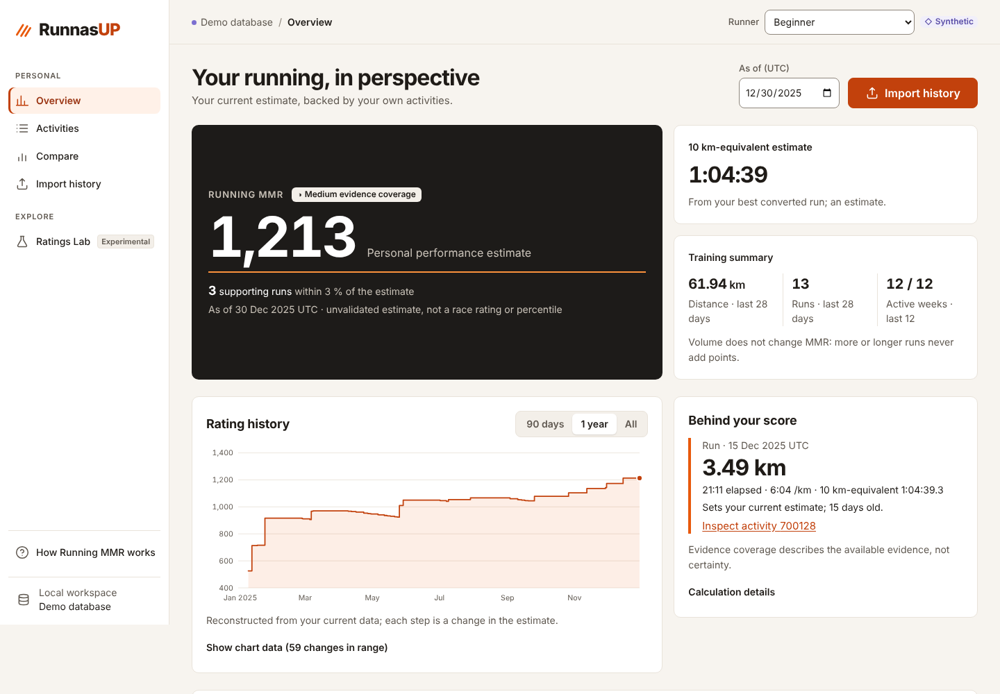
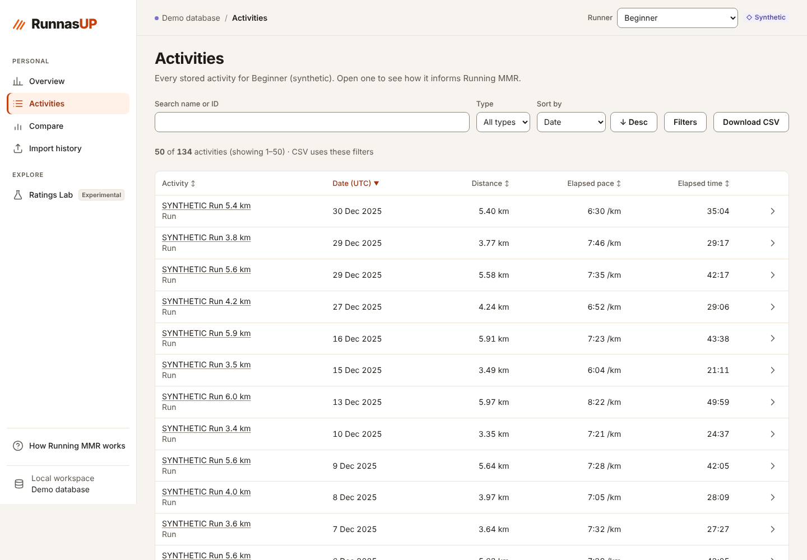
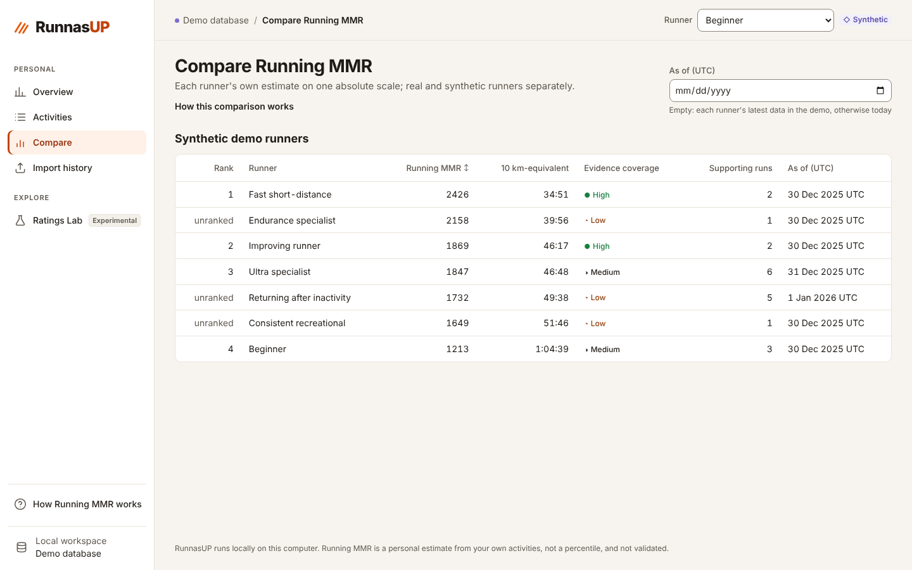
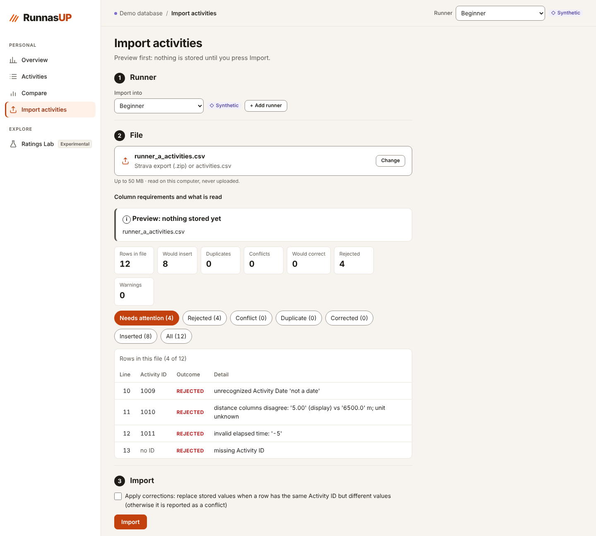
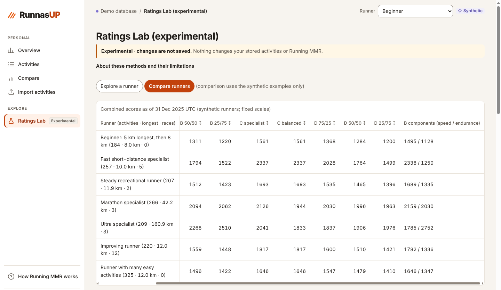

# RunnasUP

A local app that turns one runner's Strava activity history into **Running MMR**: a personal ability estimate
(a 10 km-equivalent time shown as points) with the evidence behind it. Everything runs on your own computer; there
are no accounts, no sync and no uploads.

**Status: working prototype, not validated.**
- Checked by automated tests, in-process API journeys and one headless-browser pass (Chromium, 1440 px, demo
  database), all on **synthetic** data.
- **Only partly checked in a browser:** the main pages and the import preview load without console or network errors and Tab moves
  through the controls with a visible focus ring. Small screens, other browsers, contrast, committing an import and
  the annotation flows have not been inspected.
- **No real Strava export has been imported:** the CSV column layout comes from memory of Strava's format and is
  unverified.
- Every parameter is an uncalibrated assumption.

## Screenshots

All five use the synthetic demo database; no real activity data is shown.



<sub>Overview: the current estimate, the run that set it, and how the estimate has changed.</sub>



<sub>Activities: every stored run, with search, filters and CSV export.</sub>



<sub>Compare: each runner's own estimate on one fixed scale.</sub>



<sub>Import: a preview comes first. Nothing is stored until you press Import, and every rejected row says why.</sub>



<sub>Ratings Lab (experimental): candidate methods compared on synthetic runners. The table scrolls sideways; this view is scrolled to the right-hand columns. Nothing here is saved.</sub>

## What it does
- **Import:** a Strava bulk-export `.zip` or its `activities.csv`, with a preview before anything is stored and a
  guard against importing the same file twice.
- **Overview:** the current estimate, which run set it, an evidence-coverage label (a heuristic, not a statistical
  confidence), data quality, evidence by distance, training volume (separate from the score), a history chart and
  an explanation for every change.
- **Activities:** every stored activity with search, filters, CSV export and annotations: exclude, not-a-duplicate,
  and effort labels (context only; they never change the score). Each activity page shows the estimate without and
  with that run.
- **Compare:** each runner's own estimate on one fixed scale; adding a runner never rescales anyone. Synthetic and
  real runners are never ranked together.
- **Ratings Lab (`/lab`, experimental):** compares candidate speed and endurance methods on built-in synthetic
  runners or on stored histories, read-only. Nothing there is saved.

The method, its assumptions and known failure cases are in `docs/RATING_METHOD.md`.

## Run it

```bash
python3 -m venv .venv && .venv/bin/python -m pip install -r requirements.lock   # Python 3.12
npm --prefix web ci                                                              # Node 23 (web/.npmrc sets legacy-peer-deps)
./run.sh demo    # synthetic demo database: data/demo/runrank-demo.sqlite
./run.sh         # personal database: data/runrank.sqlite (or RUNRANK_DB=<path> ./run.sh)
```

Open http://127.0.0.1:8600; the server listens on loopback only. In demo mode, **Load synthetic histories** on
the Overview adds seven invented runners. `./run.sh demo-reset` deletes only the demo database. A guided
walkthrough with expected values is in `docs/ACCEPTANCE.md`.

Before importing a real export, run the read-only inspector: `.venv/bin/python -I tools/inspect_export.py <file>`.
Real data stays under `data/`, which is never committed.

## Checks

```bash
.venv/bin/python -I -m pytest -q tests            # backend and API contract
npm --prefix web test && npm --prefix web run build
.venv/bin/python -I tools/journeys.py             # in-process API journeys (not a browser)
```

## Known limitations
- The estimate can be wrong either way. A runner who never runs hard is under-estimated. GPS noise, downhill
  courses, saved fast segments and personal endurance profiles can over-estimate it by about 50–95 points in the
  synthetic tests (§A12).
- One Riegel conversion (exponent 1.06) for 3–42.5 km; ultras are stored but do not count (§A13).
- No elevation adjustment (hilly runs are flagged). Heart rate and perceived exertion are display only.
- Older evidence counts 1.5 % slower per 30 days: an assumption, not measured detraining.

## Layout
- `runrank/`: Python API and calculations.
  - `mmr.py`: Running MMR (pure).
  - `lab_*.py`: Ratings Lab.
  - `activity_rules.py`: duplicate rule and training volume.
  - `strava_csv.py`: importer.
  - `store.py`: SQLite.
  - `api*.py`, `serve.py`: the server.
- `web/`: React/TypeScript/Vite frontend. `web/src/api/types.ts` is the API contract.
- `tests/` (pytest), `web/src/**/*.test.tsx` (Vitest), `tools/` (reports, journeys, fixture generators, export
  inspector).
- `examples/synthetic/`: invented fixtures only. `docs/evidence/`: reports generated from them.

*Names:* the app was called RunRank until 2026-10-23; the Python package `runrank/`, `RUNRANK_DB`, the database
filenames and the browser storage keys keep the old name for compatibility. Race Elo, a legacy 5K score and a
Streamlit UI were removed on 2026-10-25 and are not part of this repository.
